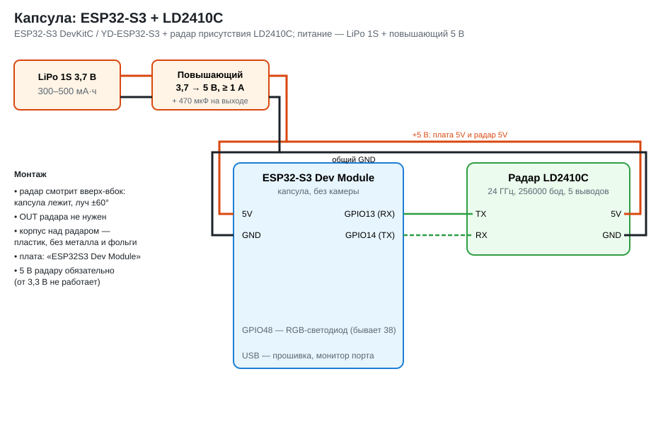

# Капсула с радаром LD2410C

Третье устройство системы «Операция — спасение». Капсулу сбрасывают с носителя (Mavic) в зону
поиска, она лежит на земле и слушает: есть ли рядом человек — идёт, стоит или **лежит без
сознания** (LD2410C видит дыхание). Тревога и дистанция идут на сервер iot-go через тот же
ретранслятор на носителе, что и у разведчика.

| | Разведчик (`rescue_scout`) | Капсула (`capsule`) |
|---|---|---|
| Радар | LD2450: до 3 целей, дистанция и угол | LD2410C: присутствие и дистанция, без угла |
| Как работает | висит на дроне, поворачивается с остановками | лежит на земле, слушает |
| Камера | есть (вариант XIAO) | нет |
| Нейросеть | трек «человек / ложная цель» | окно 10 с «человек / пусто / помеха» |
| Связь | ретранслятор, Syn/Ack, `Telemetry` | то же |



## Железо и подключение

- ESP32-S3 DevKitC или YD-ESP32-S3, в Arduino IDE — **«ESP32S3 Dev Module»**.
- LD2410C: **VCC → 5V**, GND → GND, **TX → GPIO13**, **RX → GPIO14**. OUT не нужен.
  Выводы те же, что у радара разведчика на ESP32-S3, поэтому подходит и плата-носитель
  `hardware/scout_carrier` (гироскоп и компас не ставить).
- Питание: LiPo 1S + повышающий модуль 5 В на вывод 5V (или пауэрбанк в USB).
- Радар смотрит из капсулы вверх-вбок, над ним — только пластик (металл и фольга закрывают луч).

## Прошивка

1. Библиотека TelemetryProto **версии 5** (из `telemetry.zip`, папка `esp/libraries`) — та же,
   что у разведчика и ретранслятора.
2. Открыть `capsule/capsule.ino` (рядом — `ld2410.h`, `capsule_core.h`, `capsule_nn.h`, `model.h`),
   в начале указать Wi-Fi: основная сеть — ретранслятор `scout-net`, запасная — роутер. Прошить.
3. Монитор порта 115200: строка состояния раз в секунду, `diag` — сводка.

## Как решает «человек есть» (`capsule_core.h`)

LD2410C 10 раз в секунду даёт своё решение (никого / движение / неподвижная цель),
дистанцию и **энергии по 9 зонам дальности** (по 0,75 м, до 6 м) — отдельно движения и
неподвижности.

**Правила.**
1. Кадр с отметкой — радар видит цель, и, если запомнен фон, энергия хотя бы в одной зоне
   выше фона на 10. Фон (команда `bg`, 20 с рядом никого) — земля, трава, ветки; хранится в
   памяти ESP.
2. Отметки в ≥ 60% кадров за 3 с дольше 2 с — человек есть; ≤ 20% дольше 5 с — ушёл.
   Порыв ветра, птица, одиночный всплеск — не проходят.
3. Первые 8 с после включения ничего не решается: капсула падает, качается, рядом ещё
   носитель. Команда `drop` — то же вручную.

**Нейросеть** (`capsule_nn.h` + `model.h`) — та же, что в `ld2410c_nn`: окно 10 с,
по каждой из 18 энергий — среднее, разброс и мощность в трёх полосах частот (дыхание
0,1–0,6 Гц, 0,7–2 Гц, 2–5 Гц); сеть 90 → 32 → 16 → классы. Классы — папки записей:
`pusto`, `nepodvizhen`, `dvizhetsya`, `pomeha`; вероятность «человек» = сумма двух
классов-людей. Раз в секунду, несколько миллисекунд на ESP32-S3.

Куст или ветка на ветру дают долгое движение в одной зоне и **проходят правила**. Сеть
отличает их по ритму энергии: у человека — дыхание и шаги, у куста — частое колебание.

| Режим (`nn`) | Тревога |
|---|---|
| `nn gate` | правила **и** сеть ≥ 0,5 (`nn 0.6` — порог) |
| `nn advise` | по правилам; сеть — только вероятность в телеметрию |
| `nn off` | по правилам, сеть не считается |

По умолчанию: модель на записях с капсулы — `gate`, модель на синтетике — `advise`.

**На сервер** 5 раз в секунду — снимок `Telemetry`: `alarm_active`, класс (`moving` /
`stationary`; `interference` — правила видят цель, а сеть говорит «помеха»),
`person_probability` (от сети, без неё — доля отметок), одна цель с дистанцией (угол 0:
у LD2410C его нет), `learning_background`, `background_cells`. Курса и координат нет.
При подключении — `Syn` с MAC капсулы (без оборудования), сервер отвечает `Ack`.

## Проверка без железа

`tools/capsule_sim.cpp` — тот же код (разбор байтов радара, правила, сеть) на сценах
«лес»: пусто с порывами ветра; куст качается в одной зоне; человек стоит, сидит или
лежит без сознания (только дыхание); человек ходит с остановками.

```
./capsule_sim                      сравнение: по 20 сцен каждого вида
./capsule_sim synth ../data_capsule_sim 40   синтетические записи для train.py
./capsule_sim 127.0.0.1 9000       в реальном времени на сервер: Syn/Ack, пусто -> человек -> пусто
```

Сейчас (модель на синтетике, сцены не те, на которых училась):

| Сцена | Тревог: только правила | Правила + сеть (`gate`) |
|---|---|---|
| пусто (ветер) | 0 / 20 | 0 / 20 |
| куст на ветру | **12 / 20** | **2 / 20** |
| человек неподвижен | 18 / 20 | 18 / 20, через ~4 с |
| человек движется | 20 / 20 | 20 / 20, через ~3 с |

Два пропуска — человек лежит далеко (5 м) со слабым сигналом. С `server.py`: тревога
«человек неподвижен, 2,6 м» и отбой дошли, устройство — по MAC. Цифры — проверка пути
целиком, а не качества на настоящем радаре: имитация LD2410C упрощённая.
**На железе не проверялось.**

## Обучить сеть на своих записях

1. Прошить капсулу, закрыть монитор порта. Капсулу положить, как она будет лежать после сброса.
2. Записи по 1–2 минуты (`record.py` сам включает на капсуле запись — команду `rec`):
   ```
   python record.py --port /dev/ttyACM0 --data data_capsule --label pusto --seconds 120
   python record.py --port /dev/ttyACM0 --data data_capsule --label pomeha --note "куст рядом, ветер"
   python record.py --port /dev/ttyACM0 --data data_capsule --label nepodvizhen --note "лежит 3 м"
   python record.py --port /dev/ttyACM0 --data data_capsule --label dvizhetsya --note "ходит 1-5 м"
   ```
   На каждый класс — минут 8–10 в разных местах и на разных дистанциях; `nepodvizhen` —
   стоя, сидя и лёжа.
3. Обучить (нужен только numpy) и прошить:
   ```
   python train.py --data data_capsule --out capsule/model.h
   ```
   Без файла `SYNTHETIC` в папке данных модель считается обученной на записях и включается
   в режиме `gate`. Синтетику можно добавить к записям: скопировать папки из
   `data_capsule_sim` в `data_capsule` (файл `SYNTHETIC` не копировать).

## Команды

`diag` — радар (байты, кадры, энергии по зонам), фон, сеть, связь, MAC ·
`drop` — «упала»: 8 с не решать · `bg` / `bgoff` — запомнить / забыть фон ·
`nn`, `nn gate` / `nn advise` / `nn off` / `nn 0.6` · `rec` — запись для обучения ·
`findradar` — нет данных: проверить выводы и скорость · `eng` — снова включить инженерный режим.

Светодиод: синий мигает — успокоение; голубой — запоминает фон; зелёная вспышка раз в 2 с —
всё в порядке; жёлтый — нет связи; красный часто — тревога.

## Ограничения

- **Угла нет**: сервер знает, что человек в ~N м от капсулы, но не с какой стороны.
  Место человека — круг радиусом N м вокруг капсулы; точку капсулы оператор знает по
  месту сброса (GPS в капсуле нет).
- **Ретранслятор**: до 6 подключений на все устройства (разведчики и капсулы), и одно
  держится свободным, пока смотрят видео.
- **Батарея**: ESP32-S3 с Wi-Fi и радар — около 150–200 мА; LiPo 500 мА·ч — 2–3 часа.
