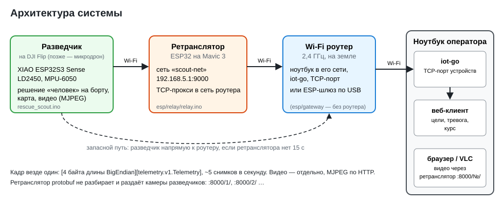

# Разведчик: поиск людей секторным сканированием (кейс «Операция — спасение»)

Техническое описание решения. Микродрон пока заменяет **DJI Flip** с навесным модулем:
вся логика поиска — в модуле, от дрона нужно только поворачиваться с остановками и висеть.



## Состав

| Узел | Железо | Код |
|---|---|---|
| Разведчик, вариант А | **XIAO ESP32S3 Sense** (камера OV2640), радар LD2450, гироскоп MPU-6050, LiPo 1S + повышающий 5 В | `rescue_scout/` |
| Разведчик, вариант Б | **ESP32-S3 DevKitC без камеры**, радар LD2450, гироскоп MPU-6050, компас по желанию | `rescue_scout/` (тот же скетч) |
| Ретранслятор на носителе | любая ESP32 на Mavic 3 | `telemetry/esp/relay/` |
| Wi-Fi роутер | 2,4 ГГц, ноутбук в его сети (без роутера — ESP-шлюз по USB, `telemetry/esp/gateway/`) | — |
| Станция оператора | ноутбук: мост `gateway_bridge.py` → сервер iot-go; журнал и отчёт миссии | `telemetry/server/` |

## Два варианта устройства

Скетч один, вариант выбирается сам по плате, выбранной в Arduino IDE:

| | А. XIAO ESP32S3 Sense | Б. ESP32-S3 без камеры |
|---|---|---|
| Плата в Arduino IDE | «XIAO_ESP32S3», PSRAM «OPI PSRAM» | «ESP32S3 Dev Module» |
| Радар LD2450 TX / RX | D7 (GPIO44) / D6 (GPIO43) | GPIO13 / GPIO14 |
| MPU-6050 (и компас) SDA / SCL | D4 (GPIO5) / D5 (GPIO6) | GPIO18 / GPIO17 |
| Светодиод для пилота | жёлтый на плате | RGB на плате |
| Видео (IP-камера) | да, MJPEG | нет — тревога, направление, дистанция |
| Масса модуля | ≈ 25 г — для полёта | больше — стенд, наземный датчик |
| Схема | [wiring_xiao.svg](wiring_xiao.svg) | [wiring_esp32s3.svg](wiring_esp32s3.svg) |
| Плата | на проводах | плата-носитель размером с ESP32-S3, модули под ней — [hardware/scout_carrier](../hardware/scout_carrier/) |

Остальное одинаково: алгоритм, связь, журнал, команды. На станции оператора вариант Б
отличается только отсутствием видео. Ещё поддерживается ESP32-CAM AI-Thinker
(`VARIANT_ESP32CAM` в начале скетча, [wiring_esp32cam.svg](wiring_esp32cam.svg)).
Вариант задаётся и вручную — `VARIANT_XIAO_SENSE` / `VARIANT_ESP32S3_NOCAM`.

## Выбранный путь: Б (радар) + камера для визуального подтверждения

- Человек ищется **радаром LD2450**: он работает в дыму, пыли и темноте, даёт дистанцию
  и угол до трёх целей сразу — это закрывает дополнительные критерии (несколько целей,
  точность направления и дистанции) без сложного компьютерного зрения.
- **Камера** — IP-камера: оператор смотрит видеопоток и подтверждает обнаружение.
  Решение «человек / не человек» принимает радар на борту; видео — для подтверждения.
- Всё на одной XIAO ESP32S3 Sense (21 × 17,5 мм, камера на плате), модуль целиком ≈ 25 г.
  Вариант без камеры (обычная ESP32-S3) решает ту же задачу без видео.

## Алгоритм

**1. Решение «человек / не человек» (на борту, `tracker.h`).** LD2450 ~10 раз в секунду
даёт до 3 точек. Точки привязываются к трекам (ближайший в пределах 0,8 м). Трек —
**человек**, если живёт ≥ 2 с и виден в ≥ 50% кадров; пропуски до 3 с допускаются
(неподвижный человек у LD2450 иногда пропадает). Отбрасываются точки ближе 0,3 м
(корпус дрона) и дальше 6 м. Класс: движется / неподвижен — по скорости и разбросу
положения за 3 с. Против мебели и стен — карта фона (команда `bg`, 20 с при пустой зоне).
Поверх правил работает **нейросеть на борту** (`track_nn.h`) — см. раздел ниже.

**2. Курс — по гироскопу (`gyro.h`).** Компас рядом с моторами и в здании ошибается на
десятки градусов, гироскопу магнитное поле безразлично. Курс = интеграл угловой скорости
вокруг вертикали; вертикаль берётся по акселерометру, поэтому MPU-6050 можно крепить
в любом положении. Смещение нуля измеряется при включении (2 с неподвижно), уход после
этого — 1–3° за сканирование. Компас, если подключён и откалиброван, даёт только азимут
от севера для карты.

**3. Секторное сканирование (`scan.h`).** Модуль не управляет дроном, а наблюдает курс:
- остановка — курс не меняется больше чем на 5° в течение 1 с;
- на остановке радар слушает 3 с; в повороте данные радара не используются (точки
  размазаны), треки сбрасываются;
- остановка закрывает сектор ±50° вокруг своего курса; когда закрыт весь круг —
  сканирование завершено, модуль переходит в наблюдение (неподвижный датчик после посадки);
- предел — 120 с.

При поворотах по 45° круг закрывается за 7 остановок: **~36 с на сектор** (ориентир
задания — около минуты).

**4. Карта обнаружения.** Каждый подтверждённый человек получает направление
`курс_остановки − курс_начала + угол_цели` и дистанцию. Если на другой остановке человек
виден в том же направлении (±20°) и на той же дистанции (±0,8 м) — это он же, счётчик
подтверждений растёт. Углы карты — **от курса в начале сканирования**: им нужен только
правильно меняющийся при повороте курс (гироскоп), а не север.

**5. Тревога и видео.** Первый человек на карте — тревога (`alarm_active`), она держится,
пока на карте есть люди. Видео идёт независимо от радара: страница `http://<разведчик>/`
показывает поток и поверх — тревогу и цели радара (дистанция, угол), опрашивая `/status`.
Камера смотрит туда же, куда радар. Видео не входит в protobuf: оно идёт по HTTP,
а через ретранслятор — по адресу `http://<ретранслятор>:8000/<номер разведчика>/`: у каждого
разведчика свой номер и своя ссылка, её разведчик отправляет серверу в `Syn`.

**6. Журнал.** События с временем: включение, отделение, вход в зону, начало
сканирования, остановки, обнаружение, тревога, тревога передана, сканирование завершено.
Журнал и карта — на разведчике: команды `log` и `map` в мониторе порта. Отделение и вход в зону пока отмечаются командами `sep`/`zone`
(на микродроне — по сигналу носителя/автопилота).

## Связь

Телеметрия — протокол iot-go (`telemetry/docs/device-protocol.md`): TCP, кадры
`[4 байта длины][protobuf]`. При подключении разведчик отправляет `Syn` — свой MAC (по нему
сервер узнаёт разведчика после переподключения) и камеру с адресом видеопотока, — сервер
отвечает `Ack`. Дальше ~5 снимков `telemetry.v1.Telemetry` (поля 1–16) в секунду: цели радара
(дистанция, угол), число людей, тревога, курс. Режим рукопожатия — `SERVER_HANDSHAKE`
(по умолчанию `HS_AUTO`: работает и с iot-go без Syn/Ack). MAC, итог рукопожатия и адрес
камеры в Syn показывает `diag`. Путь: разведчик → Wi-Fi ретранслятора на Mavic
→ Wi-Fi роутер → iot-go на ноутбуке. Если сети ретранслятора нет 15 с, разведчик
подключается к роутеру напрямую. Настройка — раздел «Ретранслятор на Mavic и Wi-Fi роутер»
в README проекта telemetry.

Видео — HTTP: `http://<разведчик>/` (страница), `:81/stream` (MJPEG), `/capture` (кадр JPEG),
`/status` (состояние радара, JSON). Через ретранслятор — `http://<ретранслятор>:8000/<номер>/`,
поток — `…/<номер>/stream`; список всех разведчиков — `http://<ретранслятор>:8000/`.
Частота кадров — команда `fps10` (по умолчанию 10 к/с): чем меньше, тем легче каналу.

## Как запустить

1. Arduino IDE: библиотека TelemetryProto из `telemetry/esp/libraries` (см. README telemetry).
2. Собрать по схеме своего варианта. Питание: 5 В от повышающего преобразователя на 1 А
   с конденсатором 470 мкФ — на вывод 5V платы и на радар.
3. Выбрать плату (вариант определится сам) и прошить `rescue_scout.ino` по USB.
   XIAO: **PSRAM «OPI PSRAM»** обязательно. В мониторе порта первой строкой —
   `вариант: XIAO ESP32S3 Sense, с камерой` или `ESP32-S3, без камеры`.
4. Проверки в мониторе порта (115200):
   - `gi` — гироскоп найден и откалиброван; повернуть модуль по часовой — курс растёт
     (иначе `gs`);
   - человек справа от оси радара — угол «+» (иначе `rx`);
   - `diag` — адрес камеры; открыть `http://<адрес>/` в браузере (вариант А).
5. Ретранслятор (`relay.ino`) — на ESP32 на Mavic: в начале скетча роутер и адрес ноутбука.
6. На ноутбуке: iot-go (`go run ./cmd/server`), открыть его TCP-порт устройств:
   `sudo firewall-cmd --add-port=8080/tcp` (порт — `server_tcp.port` в конфигурации iot-go).
7. Полёт: включить модуль **на земле и 2 с не трогать** (калибровка гироскопа), коротко
   нажать BOOT и взлететь — через 10 с начнётся сканирование. Пилот поворачивает DJI Flip
   по 45°: **светодиод горит — держать, погас — поворачивать** (медленно мигает — ждёт
   начала, часто — круг пройден, люди найдены).
8. Оператор смотрит видео на `http://<ретранслятор>:8000/` (список разведчиков, у каждого своя
   камера) и цели/тревогу в веб-клиенте iot-go.
   Карта обнаружения и журнал с отметками времени — `map` и `log` в мониторе порта разведчика.

Команды в мониторе порта: `diag`, `findi2c`, `start`, `done`, `reset`, `fps10`, `sep`, `zone`, `log`,
`map`, `g` / `gs` / `gi` (гироскоп), `bg`, `bgoff`, `rx`, `tracks`, `nn`, `rec`, `i` (компас).

## Нейросеть на борту

**Задача.** LD2450 кроме людей даёт ложные точки: отражения от стен («призраки» в
0,5–2 м за человеком), шум отдельных кадров, вибрирующие предметы (вентилятор, штора).
Правила трекера отсекают короткий шум, но устойчивый призрак проживает 2 с и выглядит
как второй человек. Нейросеть решает для каждого трека: **человек или ложная цель**.

**Вход** — 12 признаков поведения трека за последние 2 с (20 кадров радара): дальность,
доля кадров с отметкой, разброс по дальности и вбок, скорость и её разброс, доля кадров
с нулевой скоростью, смещение, средний шаг, самый длинный пропуск, смены знака скорости
(вибрация), расстояние до соседнего трека (призраки ходят рядом с человеком).
**Сеть** — полносвязная 12 → 16 → 8 → 1 (ReLU, сигмоида), 353 веса, считается на ESP32-S3
каждый кадр для каждого трека за доли миллисекунды, без библиотек. **Выход** — вероятность
«человек»: она идёт в `person_probability` снимка телеметрии и в вывод `tracks`.

**Как участвует в решении** (команда `nn`):

| Режим | Что делает |
|---|---|
| `nn gate` | человек = правила трекера **и** вероятность ≥ порога (0,5; `nn 0.6` — изменить) |
| `nn advise` | только оценка: в телеметрию и `tracks`, решают правила |
| `nn off` | сеть не считается |

По умолчанию: модель, обученная на записях с устройства, — `gate`; модель на синтетике — `advise`.

**Файлы.**

| Файл | Что |
|---|---|
| `rescue_scout/track_nn.h` | признаки и прямой проход сети — один код для прошивки, имитатора и инструментов |
| `rescue_scout/track_model.h` | веса; пишет `train_tracks.py` |
| `tools/record_tracks.py` | запись данных с устройства по USB |
| `tools/train_tracks.py` | обучение (только numpy) и экспорт `track_model.h` |
| `tools/track_data.cpp` | синтетические сцены, пересчёт признаков из старых записей, сверка C++ с Python, сравнение «правила / правила + сеть» |
| `data_tracks/` | записи: `pusto*/` — людей нет, остальные папки — человек есть; `sim_*` — синтетика |

**Сейчас в прошивке — модель, обученная на синтетике** (имитация LD2450: люди стоят, сидят
и ходят, призраки, шум, вентилятор, покачивание дрона). Результаты на новых синтетических
сценах (`./track_data eval`):

| | Людей найдено на остановках | Ложных «людей» |
|---|---|---|
| только правила | 96,7% | 960 |
| правила + сеть | 96,6% | 132 (−86%) |

Это проверка пути целиком, а не качества на настоящем радаре: сеть проверена на том же
имитаторе, на котором училась. **Перед соревнованием обучите её на своих записях.**

### Обучить на своих данных (~30 минут)

1. Прошить разведчика, закрыть монитор порта. Модуль держать так, как он будет в
   полёте (на висящем Flip или в руке на высоте ~1,5 м) — покачивание входит в данные.
2. Записи **без людей** — в разных местах, рядом со стенами, шторами, вентилятором,
   по 1–2 минуты, всего 8–10 минут:
   ```
   python tools/record_tracks.py --port /dev/ttyACM0 --label pusto --seconds 120 --note "коридор"
   ```
3. Записи **с человеком**: стоит, сидит, лежит, ходит, на 1–5 м; по 1–1,5 минуты, всего
   10–15 минут. `--zone` — дальность человека с запасом ±0,5 м (для идущего — весь путь),
   `--angle` — угол, если рядом есть другие предметы:
   ```
   python tools/record_tracks.py --port /dev/ttyACM0 --label chelovek --zone 2-3.5 --seconds 90 --note "сидит"
   python tools/record_tracks.py --port /dev/ttyACM0 --label chelovek_hodit --zone 1-5 --seconds 90
   ```
   Треки в зоне — человек, вне зоны — ложные: так размечаются призраки.
4. Обучить и прошить:
   ```
   python tools/train_tracks.py            # записи + синтетика
   python tools/train_tracks.py --no-synth # только записи
   ```
   Скрипт печатает, сколько людей сеть нашла и сколько ложных пропустила на проверочной
   части записей (последние 25% каждой), и пишет `rescue_scout/track_model.h`. Модель на
   записях включается в режиме `gate` сама. Перепрошить скетч.
5. Проверить в мониторе порта: `tracks` — у человека «сеть 80–99», у призраков и шума — низкая.
   Если сеть отбрасывает настоящих людей — `nn 0.3` или `nn advise` и дописать записи.

Строки `R` (сырые кадры) в записях сохраняются: если признаки в `track_nn.h` изменятся,
`./track_data replay старая.csv > новая.csv` пересчитает их без новой записи.

## Проверка без железа

`radar_nn/tools/scout_sim.cpp` — тот же код (mission.h, scan.h, tracker.h, кодек nanopb)
с радаром, гироскопом и поворотами по сценарию: три человека (два неподвижных, один идёт;
двое почти в одном направлении на разных дистанциях), 15% ложных точек, уход и шум
гироскопа.

```
./scout_sim          → все трое найдены по одному разу, направление ±10°, дистанция ±0,4 м
./scout_sim empty    → без людей: ложных тревог нет
./scout_sim 127.0.0.1 9000   → то же в реальном времени на сервер (iot-go)
./scout_sim gate / empty gate → то же, нейросеть решает вместе с правилами
```

Нейросеть: `./track_data check track_check.csv` — C++ на плате и Python при обучении дают
одинаковую вероятность (расхождение ~1e-6); `./track_data eval` — сравнение с правилами.

Проверено: имитатор → разбор и проверка значений из кода iot-go — все снимки приняты;
страница камеры — в браузере с имитацией потока. Скетч собран ядром ESP32 3.3.12 для обоих
вариантов (и для ESP32-CAM).
**На железе не проверялось.**

## Трек передвижения дрона (`odom.h`)

Разведчик считает, **на сколько повернулся** дрон и **где он относительно точки старта**,
и отправляет это серверу в поле `position` (и курс — в `heading_deg`) — в обычной схеме iot-go,
без новых полей. iot-go истории не хранит: трек рисует страница `telemetry/iotgo_client`
(линия облёта, точка старта, куда смотрит дрон, поворот, пройденный путь, люди на треке).
Эталонный `server.py` рисует то же на своей странице.

- **Поворот** — гироскоп MPU-6050: непрерывно, +370° = полтора оборота по часовой.
- **Перемещение** — сдвиг в осях дрона (вперёд, вправо) от источника перемещения. Датчика
  пока нет: сдвиг задаёт команда `move 1.5` (1,5 м вперёд) или `move 0 -0.5` (0,5 м влево).
  Без неё точка стоит на старте, меняется только курс. По одному гироскопу и
  акселерометру расстояние не посчитать: ошибка двойного интегрирования за 10–20 с —
  метры. В помещении подойдёт датчик оптического потока с дальномером (MTF-01,
  Matek 3901-L0X, ~5 г): он подключается к свободному UART и вызывает тот же `move()`.
- **Точка старта на карте** — один раз на месте: `home 55.751244 37.618423 90` (широта,
  долгота, куда смотрит дрон на старте — по компасу телефона). Хранится в памяти ESP.
  `az 90` — только азимут, `home off` — не отправлять координаты, `odo reset` — начать
  трек заново с текущего места, `odo` — где дрон, сколько пролетел и повернулся.
- С заданным азимутом старта у разведчика появляется и курс от севера (`heading_deg` =
  азимут старта + поворот по гироскопу), поэтому сервер ставит людей на карту:
  точка дрона + азимут + дистанция.

Точность: поворот — гироскоп уходит на 1–2° в минуту; положение — настолько точно,
насколько точен источник перемещения (с `move` — как отметил оператор).

## Ограничения и что дальше

- **Радар на висящем дроне не проверен.** С LD2410C на дроне были постоянные ложные
  срабатывания; LD2450 даёт координаты и трекер отсекает ближние точки, но вибрация и
  покачивание — главный риск. Проверить первым делом; запасной вариант — сканировать
  после посадки (тот же код, носитель поворачивается на земле).
- **Вибрация моторов и гироскоп.** В MPU-6050 включён фильтр 44 Гц; если на висении
  курс «плывёт» больше пары градусов в минуту — модуль крепить через мягкую прокладку.
- **Питание**: просадка 5 В при передаче Wi-Fi — перезагрузка. Признак — в мониторе
  порта `Brownout detector was triggered`; помогает конденсатор 470 мкФ.
- **Антенна XIAO** — внешняя, на шлейфе (в комплекте): без неё связь на несколько метров.
- **Темнота**: у XIAO нет подсветки; в затемнённой зоне видео будет тёмным — нужен
  светодиод подсветки (через транзистор от свободного вывода D0–D3). Радар работает и в темноте.
- **Канал**: видео через ретранслятор занимает эфир дважды (разведчик → ретранслятор →
  роутер). Если телеметрия начинает рваться, снизьте частоту: `fps5`.
- Камера смотрит туда же, куда радар, обзор уже (±30° против ±60°): человек у края сектора
  радара может быть вне кадра — на странице камеры виден угол цели, оператор дождётся
  остановки, где человек ближе к оси.
- Отделение и вход в зону отмечаются вручную; механизм отделения на Mavic (серво на
  ретрансляторе) ещё не сделан.
- Карта — относительно точки сканирования; объединение карт нескольких точек требует
  положения дрона в помещении (оптический поток) — на микродроне.
