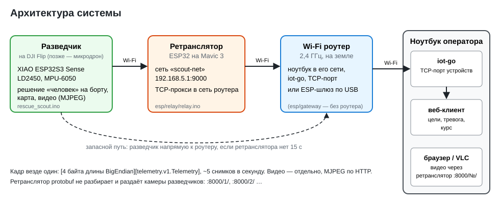

# Телеметрия ESP32 ↔ сервер на protobuf

Схемы сообщений — `proto/telemetry/v1/telemetry.proto` (снимок) и `synack.proto`
(рукопожатие Syn/Ack при подключении). Из них easyp генерирует C-код для ESP32 (nanopb)
и Python-код для сервера.

```
.
├── easyp.yaml                         линтер + генерация
├── api/openapi.yaml                   HTTP API для клиентов (OpenAPI 3.1)
├── docs/device-protocol.md            протокол устройств — для авторов серверов
├── docs/iot-go/                       документы сервера iot-go: протокол Syn/Ack, туториал клиента
├── docs/web-api.md                    HTTP API — для авторов страниц и клиентов
├── docs/system.svg                    архитектура: разведчик — ретранслятор — шлюз — ноутбук
├── proto/telemetry/v1/telemetry.proto схема снимка
├── proto/telemetry/v1/synack.proto    Syn (MAC, оборудование) и Ack — первый обмен подключения
├── esp/
│   ├── libraries/TelemetryProto/      Arduino-библиотека
│   │   └── src/
│   │       ├── pb*.c/h                nanopb 0.4.9.2 (среда выполнения)
│   │       ├── telemetry/v1/*.pb.c/h  ← генерируется (telemetry, synack)
│   │       ├── telemetry_codec.h      кадры [4 байта длины BE][сообщение] + проверка значений
│   │       └── TelemetryLink.h        Wi-Fi + TCP + Syn/Ack + переподключение, отправка снимков
│   ├── telemetry_client/              демо-скетч без датчиков
│   ├── gateway/                       ESP-шлюз: точка доступа + USB к ПК
│   └── relay/                         ретранслятор на носителе: Wi-Fi разведчиков -> Wi-Fi роутера -> ноутбук
├── tools/fake_device.cpp              «ESP на компьютере» для проверки сервера
├── tools/pc_link.h                    подключение с Syn/Ack для программ на ПК
├── tools/codec_test.cpp               проверочные векторы кадров (Telemetry, Syn, Ack)
├── tools/sim_device.py                имитатор устройств с радаром (люди ходят, тревоги)
├── tools/check_api.py                 проверка сервера на соответствие api/openapi.yaml
└── server/
    ├── server.py                      сервер (asyncio)
    ├── gateway_link.py                связь с ESP-шлюзом по USB
    ├── gateway_bridge.py              мост: ESP-шлюз (USB) -> TCP-сервер, например iot-go
    ├── mission_log.py                 журнал миссии (для схемы с полями 17–20; со схемой iot-go выключен)
    ├── web.py                         HTTP API v1 и раздача страницы
    ├── web/index.html                 страница оператора (клиент API)
    ├── requirements.txt
    └── gen/telemetry/v1/*_pb2.py      ← генерируется
```

## Установка инструментов (один раз)

1. **easyp** v0.17: `go install github.com/easyp-tech/easyp/cmd/easyp@v0.17.0`
   или готовый файл `easyp-0.17.0-<ОС>-<архитектура>.tar.gz` со страницы релизов на GitHub.
2. **Генератор nanopb** (плагин `protoc-gen-nanopb`): `pip install nanopb==0.4.9.2`.
   Версия должна совпадать с файлами `pb*.c/h` в библиотеке. Папка Scripts Python
   должна быть в PATH (проверка: `protoc-gen-nanopb --version` не ругается «не найдено»).
3. **Сервер**: `pip install -r server/requirements.txt`. Python-код easyp генерирует
   встроенным генератором, отдельный protoc не нужен.

## Работа со схемой

```sh
easyp lint --root proto     # проверка стиля схемы
easyp generate              # C для ESP и Python для сервера
easyp breaking --against main   # нет ли несовместимых изменений относительно ветки main (нужен git)
```

После `easyp generate` перепрошить ESP и перезапустить сервер.

Правила изменения схемы, чтобы старые и новые прошивки понимали друг друга:
- новые поля — с новыми номерами; номера и типы существующих полей не менять;
- удалённое поле — `reserved <номер>;`, номер больше не использовать;
- `string`, `bytes` и `repeated` в nanopb требуют размера: файл
  `proto/telemetry/v1/telemetry.options`, например `telemetry.v1.Telemetry.tracks max_count:6`
  (easyp.yaml уже передаёт генератору `--options-path: proto`).
  Без этого nanopb сгенерирует колбэки вместо массивов.

## ESP32 (Arduino IDE)

1. Сделать библиотеку видимой для Arduino IDE — ссылкой, чтобы после `easyp generate`
   ничего не копировать:
   - Windows (cmd): `mklink /J "%USERPROFILE%\Documents\Arduino\libraries\TelemetryProto" "<путь>\esp\libraries\TelemetryProto"`
   - Linux/macOS: `ln -s "$PWD/esp/libraries/TelemetryProto" ~/Arduino/libraries/`
2. Открыть `esp/telemetry_client/telemetry_client.ino`, указать Wi-Fi и IP сервера, прошить.
3. Нажать BOOT — 10 с устройство сообщает о человеке (`alarm_active`), на сервере появится тревога.

В своём скетче:

```cpp
#include <TelemetryLink.h>
TelemetryLink telem;
telem.begin({"ssid", "pass", "192.168.4.1", 9000});

// каждые 200 мс — полный снимок состояния
telemetry_v1_Telemetry t = telemetry_v1_Telemetry_init_zero;
t.firmware_version = 3;
t.uptime_s = millis() / 1000;
t.radar_ok = true;
t.alarm_active = alarmOn;
telem.publish(t);            // не ждёт сеть: в очереди хранится только последний снимок
```

Сетевая работа идёт в отдельной задаче FreeRTOS на ядре 0: переподключения
не тормозят `loop()`. Если сеть не успевает, старый снимок заменяется новым
(счётчик `telem.replacedCount`) — это нормально, важен только последний. Имя `link` для объекта не годится — так называется системная функция.

## Сервер команды iot-go (Go)

Прошивки подключаются к нему без изменений: тот же порт 9000, кадр
`[4 байта длины BigEndian][protobuf]`, рукопожатие Syn/Ack (`docs/iot-go/device-protocol.md`),
те же ограничения значений.

Рукопожатие (`SERVER_HANDSHAKE` в скетче) по умолчанию `HS_AUTO`: устройство шлёт Syn и ждёт
Ack 3 с; если сервер Ack не прислал (iot-go без Syn/Ack), снимки идут дальше — прошивка
работает и с нынешним, и с новым iot-go. Когда новый iot-go развёрнут, можно поставить
`HS_STRICT` — строго по его документу. Сервер узнаёт устройство по MAC из Syn.

- **Устройства в одной сети Wi-Fi с ПК, где работает iot-go:** в скетче `SERVER_HOST` — IP этого ПК,
  `SERVER_PORT = 9000`.
- **Устройства через ESP-шлюз:** шлюз по USB к ПК, на ПК вместе с iot-go запустить мост
  ```sh
  pip install pyserial
  python server/gateway_bridge.py --serial /dev/ttyACM0 --server 127.0.0.1:9000
  ```
  Мост открывает для каждого устройства шлюза отдельное TCP-подключение к iot-go.

Проверка без железа: `go run ./cmd/server` в iot-go, затем
`python tools/sim_device.py --count 2` здесь (`--fly` — устройства летают по помещению, на странице
оператора рисуется трек) — в `GET http://localhost:8080/api/v1/devices` появятся два
устройства. iot-go с Syn/Ack сохраняет идентификатор для MAC; старый — выдаёт новый UUID на каждое подключение.

iot-go и `server.py` занимают одни и те же порты (9000 и 8080), поэтому на одном ПК их
запускают по очереди. Страница оператора из этого проекта работает только с `server.py`:
у iot-go свой веб-API (список устройств и WebSocket `/api/v1/devices/{uuid}`).

## Поиск людей: разведчик, ретранслятор, журнал миссии



- **Разведчик** — `radar_nn/rescue_scout` (LD2450 + гироскоп MPU-6050; два варианта: XIAO ESP32S3 Sense с камерой и обычная ESP32-S3 без камеры): секторное
  сканирование, карта обнаружения, журнал событий в мониторе порта, видеопоток с камеры
  (IP-камера, MJPEG). Описание — README там же.
- **Капсула** — `radar_nn/capsule` (ESP32-S3 + LD2410C): сбрасывается с носителя, лежит и
  слушает; тревога и дистанция до человека тем же путём (ретранслятор, Syn/Ack, `Telemetry`),
  камеры нет. Описание — README там же.
- **Ретранслятор** (`esp/relay/relay.ino`) — ESP32 на носителе: раздаёт сеть `scout-net`
  (192.168.5.1) и пересылает TCP разведчиков через Wi-Fi роутер на ноутбук. Подробно —
  раздел «Ретранслятор на Mavic и Wi-Fi роутер» ниже.
- **Схема** — как у iot-go, поля 1–16. Карта обнаружения и журнал событий остаются на
  разведчике (монитор порта: `map`, `log`); на сервер уходят цели, тревога и курс.
- **Видео** — отдельно от protobuf: разведчик — IP-камера `http://<адрес>/`, поток MJPEG
  `:81/stream`; через ретранслятор — `http://<ретранслятор>:8000/<номер разведчика>/`.

Проверка без железа — имитатор разведчика `radar_nn/tools/scout_sim.cpp` (тот же код, что
в прошивке) напрямую на сервер: `./scout_sim 127.0.0.1 9000`.

## Ретранслятор на Mavic и Wi-Fi роутер

```
разведчик ──Wi-Fi «scout-net»──> ретранслятор (Mavic) ──Wi-Fi роутера──> ноутбук: iot-go (TCP-порт устройств)
     └──────── запасной путь: напрямую к роутеру, если ретранслятора нет 15 с ────────┘
```

**Порт.** Ретранслятор и разведчик шлют кадры `[4 байта длины][Telemetry]` в TCP-порт
устройств iot-go — `server_tcp.port` в `configs/config.yaml`. В прошивках стоит **8080**
(`SERVER_PORT` в `relay.ino`, `SERVER_PORT2` в `rescue_scout.ino`). В репозитории iot-go по
умолчанию TCP-порт устройств — 9000, а 8080 — веб-API (`server_http`): если конфигурация не
менялась, поставьте в прошивках 9000. По HTTP-порту кадры не примутся.

**Роутер.** Диапазон 2,4 ГГц (ESP32 не работает на 5 ГГц). Сеть роутера не должна быть
192.168.5.x — это сеть разведчиков (если совпала, ретранслятор напишет об этом).

**Ноутбук (Bazzite).**
```sh
go run ./cmd/server                      # iot-go (в его папке)
sudo firewall-cmd --add-port=8080/tcp    # открыть порт устройств (--permanent — насовсем)
hostname                                 # имя ноутбука: для «имя.local»
```
Если имя `*.local` не находится, укажите IP ноутбука (`ip -4 addr`) и закрепите его в роутере
(«резервирование адреса DHCP»).

**Ретранслятор** (`esp/relay/relay.ino`, любая ESP32, лучше с внешней антенной): в начале
скетча `ROUTER_SSID`, `ROUTER_PASS`, `SERVER_HOST` (IP ноутбука или `bazzite.local`),
`SERVER_PORT`. При включении он находит роутер и поднимает сеть разведчиков на его канале.
Питание на Mavic — свой аккумулятор 1S с повышающим до 5 В или маленький пауэрбанк.

**Разведчик** (`rescue_scout.ino`): основная сеть `scout-net` / `192.168.5.1:9000` (уже так),
запасная — роутер: `WIFI_SSID2`, `WIFI_PASS2`, `SERVER_HOST2` = ноутбук, `SERVER_PORT2`.

**Видео, в том числе с нескольких разведчиков.** Разведчики в сети ретранслятора, ноутбук — в
сети роутера, поэтому камеры раздаёт ретранслятор, через один порт 8000. Каждый разведчик
получает номер (1–4), он виден в мониторе ретранслятора:

| Адрес | Что |
|---|---|
| `http://<ретранслятор>:8000/` (или `http://scout-relay.local:8000/`) | список разведчиков со ссылками |
| `http://<ретранслятор>:8000/2/` | страница камеры разведчика №2: поток, тревога, цели |
| `http://<ретранслятор>:8000/2/stream` | поток MJPEG №2 — для VLC/OBS |

Свою ссылку каждый разведчик сам отправляет серверу в `Syn` (`camera` — поток,
`camera_page` — страница), поэтому в API сервера у каждого устройства своя камера.
Номер закреплён за адресом разведчика, пока ретранслятор включён.

Ограничения ретранслятора (одна ESP32):
- **Сокетов** у ESP32 16 на всё, поэтому пар подключений 6, и одна всегда держится для
  телеметрии. Четыре разведчика с телеметрией оставляют место одному-двум открытым потокам;
  два разведчика — трём-четырём. Лишнему зрителю ретранслятор отвечает «занят».
- **Скорость.** Поток VGA при 10 кадрах/с — около 2–3 Мбит/с, а у ESP32 одно радио на обе
  сети. Смотрите несколько камер сразу — уменьшайте частоту на разведчиках: команда `fps3`.

Адрес ретранслятора он печатает в мониторе порта при подключении к роутеру. Если разведчик подключился к роутеру напрямую
(запасная сеть) — `http://<адрес разведчика>/`, адрес в `diag`.

**Проверка без дрона:** ноутбук, роутер, ретранслятор и разведчик на столе. В мониторе
ретранслятора — «разведчик ... подключён к серверу», в `diag` разведчика — «Wi-Fi есть,
сервер подключён, сеть scout-net», в iot-go — новое устройство (`GET /api/v1/devices`).

## Трек дронов для iot-go

`iotgo_client/` — страница оператора поверх iot-go: трек передвижения каждого устройства
(из `position` и `heading_deg` в снимках), поворот, пройденный путь, люди на треке, выгрузка
в GeoJSON. iot-go не меняется: `python iotgo_client/iotgo_view.py --iotgo <адрес iot-go>:8080`,
открыть `http://localhost:8090/`. Подробно — `iotgo_client/README.md`.

## Сервер (свой, на Python)

```sh
python server/server.py --port 9000
```

Команды в консоли: `list`, `quit`. Устройство сервер называет по его IP-адресу.
Тревогу сервер выводит сам из признака `alarm_active` в снимках: `false → true` — тревога,
`true → false` — отбой. Обе записи пишутся в `alarms.jsonl`. Ноутбук и ESP — в одной сети Wi-Fi
(точка доступа Windows обычно имеет адрес 192.168.137.1), порт 9000 открыть в брандмауэре.

## API для сторонних разработчиков

| Кому | Документ | Формальное описание | Проверка |
|---|---|---|---|
| пишет свой сервер | `docs/device-protocol.md` | `proto/telemetry/v1/telemetry.proto` | `tools/sim_device.py` |
| пишет страницу или клиент | `docs/web-api.md` | `api/openapi.yaml` (OpenAPI 3.1) | `tools/check_api.py` |

Эталонный сервер (`server/server.py`) реализует оба контракта: устройства подключаются к нему
по протоколу из `device-protocol.md`, клиенты читают HTTP API `http://<сервер>:8080/api/v1`
(REST + поток событий SSE, CORS открыт). Страница оператора — пример клиента этого API.

## Страница оператора

Сервер сам показывает страницу: **http://localhost:8080** (с телефона или планшета в той же сети —
по IP этого ПК, порт 8080 открыть в брандмауэре). Интернет не нужен.

- Для каждого устройства — сектор радара: подтверждённые люди оранжевым с дистанцией, углом
  и азимутом, цели «на проверке» серым, след движения. «Север вверху» поворачивает картинку по компасу.
- Полоса тревоги сверху с текущим положением человека и ссылкой на точку на карте (нужен интернет
  только для самой карты).
- Журнал тревог, звук тревоги (включается кнопкой — так требуют браузеры).
- Команд устройству нет: фон запоминается командой `bg` в мониторе порта устройства,
  компас калибруется скетчем `nav_test`.

Без радара страницу можно посмотреть с имитатором устройств:
```sh
python server/server.py            # в одном окне
python tools/sim_device.py --count 2   # в другом
```

Порт страницы меняется `--http-port`, `--http-port 0` отключает страницу.
Цели для картинки приходят в каждом снимке `Telemetry` (~5 раз в секунду).

## ESP-шлюз: точка доступа + USB к ПК

```
ESP с радаром ──Wi-Fi──> ESP-шлюз (192.168.4.1:9000) ──USB──> server.py --serial
```

Шлюз (`esp/gateway/gateway.ino`) раздаёт Wi-Fi `drone-net` / `12345678` и пересылает байты
каждого устройства на ПК по USB, не разбирая protobuf. ПК остаётся в своей сети
с интернетом, настраивать IP не нужно. Тот же шлюз потом можно поставить на Mavic как ретранслятор.

1. Прошить `esp/gateway/gateway.ino` на вторую ESP (библиотеки не нужны). Настройки — в начале файла.
2. В скетчах устройств: `WIFI_SSID`/`WIFI_PASS` как у шлюза, `SERVER_HOST = "192.168.4.1"`.
3. Подключить шлюз к ПК по USB и запустить сервер:
   ```sh
   ls /dev/ttyACM* /dev/ttyUSB*          # какой порт у шлюза
   python server/server.py --serial /dev/ttyACM0 --no-tcp
   ```
   Без `--no-tcp` сервер принимает устройства и по Wi-Fi напрямую, и через шлюз одновременно.
4. В журнале сервера раз в минуту: `шлюз на связи: устройств N`. При запуске сервер
   сбрасывает подключения шлюза — устройства переподключаются за несколько секунд.

Протокол по USB: `A5 | тип | клиент | длина (2 байта) | данные | CRC-8`, типы CONNECT, DATA,
DISCONNECT, STATUS, RESET (`esp/gateway/gw_link.h`, `server/gateway_link.py`). Битые кадры
и посторонние байты (например, вывод загрузчика ESP при старте) пропускаются.

Linux: доступ к порту — группа `dialout` (на Bazzite её сначала добавить в /etc/group, см. выше).
Монитор порта Arduino для шлюза бесполезен: там только двоичные кадры.

## Проверка сервера без ESP

`tools/fake_device.cpp` — программа для Linux/macOS/WSL, которая ведёт себя как ESP:
тот же код nanopb и те же кадры. 15 с шлёт снимки: без людей, с человеком (тревога), снова
без людей (через 5 с — отбой). Сборка — в комментарии в начале файла, запуск: `./fake_device 127.0.0.1 9000`
(`strict` / `off` третьим аргументом — режим рукопожатия). `tools/codec_test.cpp` — векторы кадров.

## Протокол

| Что | Как |
|---|---|
| Кадр | `[длина тела: 4 байта, uint32 BigEndian][сообщение]` — формат iot-go; вектор `Telemetry{uptime_s:1}` → `00 00 00 02 10 01` |
| Подключение | ESP → `Syn` (MAC 6 байт, камера и её адрес), сервер → `Ack` (`code 0` — принят); вектор `Syn{mac:02:11:22:33:44:55}` → `00 00 00 08 0A 06 02 11 22 33 44 55` |
| ESP → сервер | `Telemetry` — полный снимок состояния, ~5 раз в секунду (до 279 байт) |
| Значения | NaN, курс ≥ 360°, отрицательные дистанции и т.п. сервер не принимает — прошивка исправляет их перед отправкой |
| Сервер → ESP | только `Ack` на `Syn`, дальше ничего |
| Идентификатор | MAC из `Syn`; старые прошивки без Syn — IP-адрес (эталонный сервер) |
| Тревога | состояние `alarm_active`, а не событие; устройство держит его ≥ 5 с, то есть ≥ 25 снимков |
| Обрыв | ESP переподключается при ошибке отправки (паузы 1–10 с) и снова делает Syn/Ack; сервер отключает устройство после 5 с без кадра |

Подробно — `docs/device-protocol.md`.
